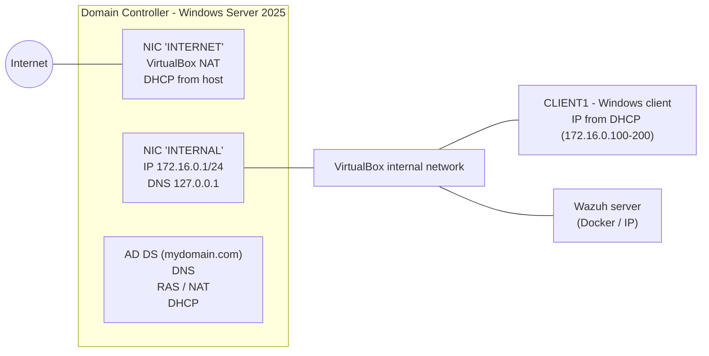
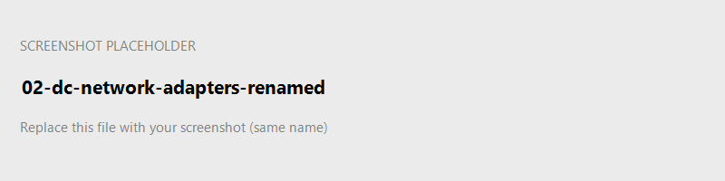
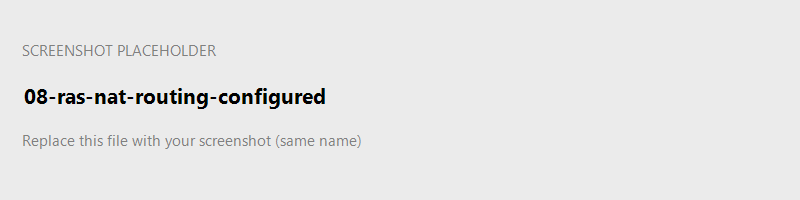
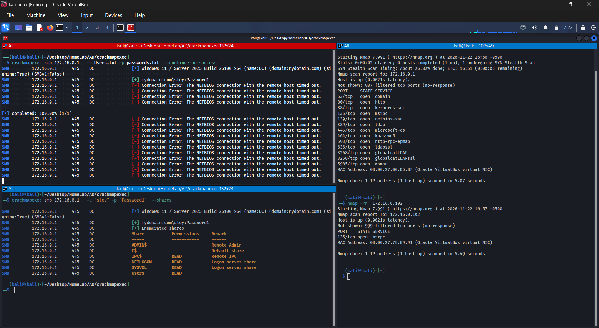

# Active Directory Home Lab

> **Status: work in progress.** The lab is built and running. I'm still adding the documentation, screenshots and alert triage notes, especially for the Wazuh part.

A small Active Directory lab I built in VirtualBox to understand how a company network works from the inside: a domain controller that gives out IP addresses (DHCP), routes clients to the internet (NAT), and manages users, a Windows client that joins the domain, and Wazuh to monitor the machines and triage alerts.


## Architecture



| Item | Value |
|---|---|
| Hypervisor | Oracle VirtualBox |
| Domain controller | Windows Server 2025, 2 network adapters |
| Client | Windows <!-- TODO: 10 or 11? --> |
| Domain | `mydomain.com` |
| DC internal IP | `172.16.0.1` / `255.255.255.0`, no gateway, DNS `127.0.0.1` |
| DHCP scope | `172.16.0.100` - `172.16.0.200`, mask `255.255.255.0`, gateway and DNS `172.16.0.1` |


## 1. Network adapters on the DC

The DC has two adapters:
- **INTERNET** (VirtualBox NAT): gets an address from VirtualBox (starts with `10.`), so the DC can reach the internet.
- **INTERNAL** (VirtualBox internal network): talks to the clients.

Before configuring anything, the internal adapter had an address starting with `169.254.` (APIPA). That means it asked for an IP from a DHCP server and got no answer, which is normal because there was no DHCP server yet. I renamed both adapters so I don't mix them up later.



Then I gave the internal adapter a static IP (Properties > IPv4):

```
IP       172.16.0.1
Mask     255.255.255.0
Gateway  (empty)
DNS      127.0.0.1   (the DC will be its own DNS server)
```


## 2. Install Active Directory and promote the DC

- Server Manager > Add roles and features > **Active Directory Domain Services**.
- Clicked the yellow flag > **Promote this server to a domain controller** > **Add a new forest** > `mydomain.com`.
- The server reboots (it took a long time for me, around 30 min).


## 3. Dedicated admin account

Instead of using the built-in Administrator, I created my own admin:
- In **Active Directory Users and Computers**, created an OU for admins <!-- TODO: put the real OU name --> (an OU is like a folder to organise users and computers and apply policies to them).
- Created a user in it and added it to the **Domain Admins** group.
- Signed out and signed back in with this account.


## 4. RAS / NAT (so clients can reach the internet through the DC)

- Add roles and features > **Remote Access** > role service **Routing**.
- Tools > Routing and Remote Access > right click the DC > Configure > **NAT**, using the INTERNET adapter as the public interface.
<!--

-->
## 5. DHCP

DHCP gives an IP address automatically to new devices on the network.

- Add roles and features > **DHCP Server**.
- Tools > DHCP > IPv4 > New scope: range `172.16.0.100-200`, router (gateway) `172.16.0.1`, DNS `172.16.0.1`.
- Right click the server > **Authorize**, then refresh (the IPv4 icon turns green).


## 6. Create users with PowerShell

To have realistic data, I created many users at once with a PowerShell script from Josh Madakor's [AD_PS repository](https://github.com/joshmadakor1/AD_PS) (not my script, credit to him).

```powershell
# allow scripts only for this PowerShell window
Set-ExecutionPolicy -Scope Process -ExecutionPolicy Bypass
.\1_CREATE_USERS.ps1
```

`-Scope Process` means the policy only changes for this session, not for the whole machine.


## 7. Join the client to the domain

- Client VM on the **internal network** only.
- Checked it received an IP from the DC with `ipconfig /all` (172.16.0.x, DNS 172.16.0.1).
- Settings > Rename this PC (advanced) > Change > member of domain `mydomain.com`, using the admin account.
- Rebooted and signed in with one of the created domain users.
<!--


-->
On the DC, the client shows up in the DHCP leases and in AD Users and Computers > Computers:
<!--

-->

## 8. Basic attacks

I used a created a username file , for simplicity i created the user.txt file from the users i already added the AD users . and added the password at the top of the password.txt file. 
i then used crackmapexec to enumerate the users and try to find a valid user which and did and used his creds to list the shares.



## 8. Monitoring with Wazuh

After the domain was working, I added Wazuh (open-source SIEM / XDR) to gain visibility into events occurring across the lab environment and to practice alert analysis and triage.

| Item | Value |
|---|---|
| Wazuh server | Ubuntu Server 22.04 VM (172.16.0.10) |
| Agents installed on | DC01 (Windows Server 2022), CLIENT1 (Windows 11) |
| Wazuh version | 4.8.x |

### Alert triage

When an alert appeared, I first checked the rule level and description to understand its severity. I then identified the affected host, user account, timestamp, and associated events. Next, I correlated the alert with actions I had performed in the lab to determine whether it was expected activity, a false positive, or something requiring further investigation. Finally, I documented the finding and decided whether the rule required tuning.

| Alert (rule ID / description) | Host | What caused it | Verdict | Action |
|---|---|---|---|---|
| Windows failed login attempts | DC01 | Intentionally tested incorrect passwords while validating domain authentication | Expected activity | Documented |
| New local administrator account created | DC01 | Created a test account during privilege management exercises | Expected activity | Documented |
| PowerShell execution detected | CLIENT1 | Administrative PowerShell commands used for system configuration | Expected activity | Reviewed command history and documented |
| Multiple authentication failures | CLIENT1 | User attempted logins with an expired password | False positive / expected | No action required |
| Service installation detected | DC01 | Installed Sysmon and monitoring components | Expected activity | Verified and documented |


## Problems I Hit

### DNS misconfiguration prevented domain join

The Windows client could not locate the Active Directory domain during the join process.

**Root cause:** The client was using an external DNS server instead of the Domain Controller.

**Fix:** Updated the client's preferred DNS server to point to the Domain Controller and verified name resolution using `nslookup`.

### Client had internet access but could not resolve domain resources

Users could reach external IP addresses but could not access domain services.

**Root cause:** Incorrect DNS configuration.

**Fix:** Configured Active Directory DNS as the primary DNS server and verified SRV record resolution.

### Wazuh agent not appearing in the dashboard

After installing an agent, it did not show as connected.

**Root cause:** Agent registration and connectivity issue between the endpoint and the manager.

**Fix:** Re-registered the agent, verified connectivity to the manager, restarted the Wazuh service, and confirmed successful enrollment.

## What I Learned

- Active Directory heavily depends on DNS; many domain-related issues are actually DNS issues.
- Building security monitoring into an environment provides much better visibility than relying only on endpoint observations.
- Not every alert represents malicious activity. Context is essential before escalating an incident.
- Event correlation is important because a single alert rarely provides the complete picture.
- Proper logging and monitoring make troubleshooting significantly easier.
- Understanding normal system behavior helps identify genuine anomalies and suspicious activity.

## Next Steps

- [ ] Group Policy: password policy, lock screen, disable USB storage
- [ ] Add a second client and compare activity across hosts
- [ ] Configure Sysmon for enhanced endpoint visibility
- [ ] Simulate attacks (Kerberoasting, AS-REP Roasting) and analyze detections in Wazuh
- [ ] Create custom Wazuh dashboards and detection rules
- [ ] Deploy an MCP server exposing Active Directory management functions
- [ ] Integrate an LLM (Claude / other MCP-compatible assistant) to perform supervised administrative tasks such as:
  - Creating and disabling users
  - Managing groups and permissions
  - Querying AD health and user information
  - Reviewing authentication events
  - Generating security and compliance reports
- [ ] Add approval workflows and role-based access controls to ensure AI-driven actions remain secure and auditable
- [ ] Investigate AI-assisted SOC workflows by combining Active Directory, Wazuh alerts, and MCP tools

