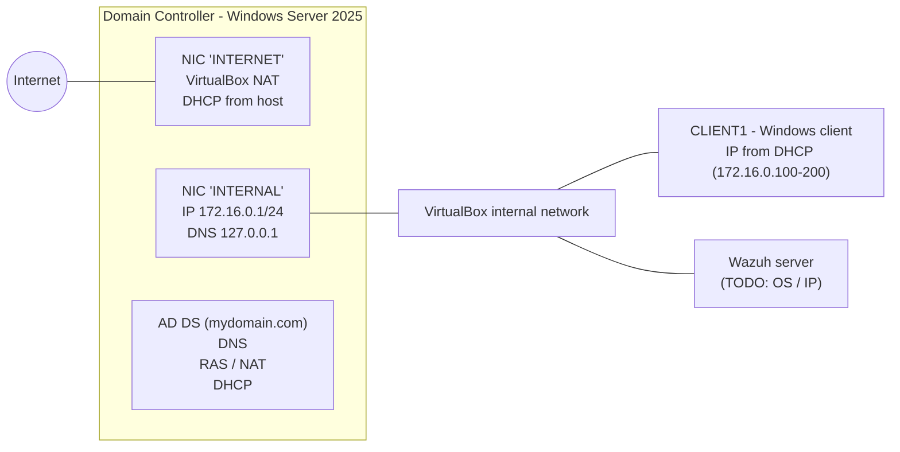
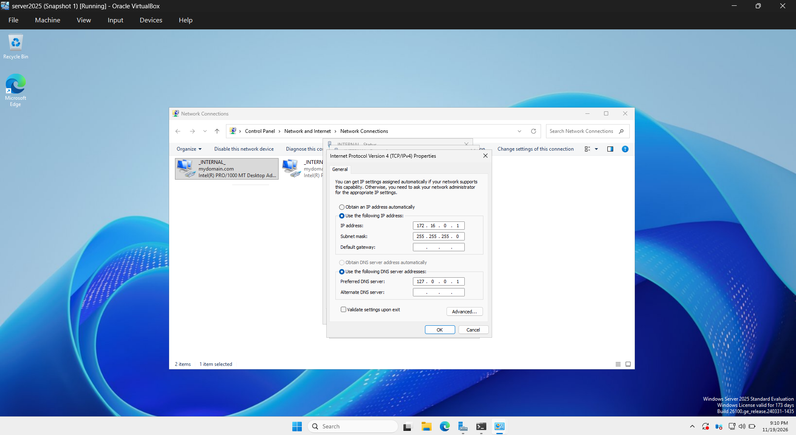
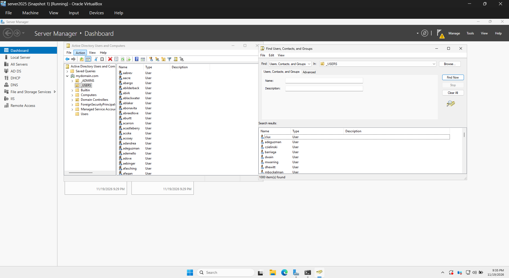
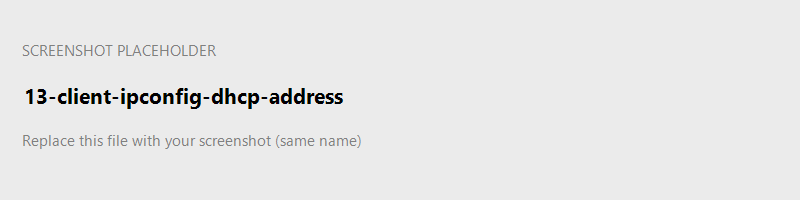
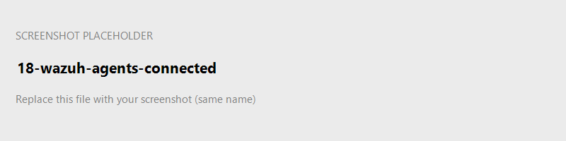

# Active Directory Home Lab

> **Status: work in progress.** The lab is built and running. I'm still adding the documentation, screenshots and alert triage notes, especially for the Wazuh part.

A small Active Directory lab I built in VirtualBox to understand how a company network works from the inside: a domain controller that gives out IP addresses (DHCP), routes clients to the internet (NAT), and manages users, a Windows client that joins the domain, and Wazuh to monitor the machines and triage alerts.


## Architecture



| Item | Value |
|---|---|
| Hypervisor | Oracle VirtualBox |
| Domain controller | Windows Server 2025, 2 network adapters |
| Client | Windows <!-- TODO: 10 or 11? --> |
| Domain | `mydomain.com` |
| DC internal IP | `172.16.0.1` / `255.255.255.0`, no gateway, DNS `127.0.0.1` |
| DHCP scope | `172.16.0.100` - `172.16.0.200`, mask `255.255.255.0`, gateway and DNS `172.16.0.1` |


## 1. Network adapters on the DC

The DC has two adapters:
- **INTERNET** (VirtualBox NAT): gets an address from VirtualBox (starts with `10.`), so the DC can reach the internet.
- **INTERNAL** (VirtualBox internal network): talks to the clients.

Before configuring anything, the internal adapter had an address starting with `169.254.` (APIPA). That means it asked for an IP from a DHCP server and got no answer, which is normal because there was no DHCP server yet. I renamed both adapters so I don't mix them up later.


Then I gave the internal adapter a static IP (Properties > IPv4):

```
IP       172.16.0.1
Mask     255.255.255.0
Gateway  (empty)
DNS      127.0.0.1   (the DC will be its own DNS server)
```



## 2. Install Active Directory and promote the DC

- Server Manager > Add roles and features > **Active Directory Domain Services**.
- Clicked the yellow flag > **Promote this server to a domain controller** > **Add a new forest** > `mydomain.com`.
- The server reboots (it took a long time for me, around 30 min).


## 3. Dedicated admin account

Instead of using the built-in Administrator, I created my own admin:
- In **Active Directory Users and Computers**, created an OU for admins <!-- TODO: put the real OU name --> (an OU is like a folder to organise users and computers and apply policies to them).
- Created a user in it and added it to the **Domain Admins** group.
- Signed out and signed back in with this account.


## 4. RAS / NAT (so clients can reach the internet through the DC)

- Add roles and features > **Remote Access** > role service **Routing**.
- Tools > Routing and Remote Access > right click the DC > Configure > **NAT**, using the INTERNET adapter as the public interface.
<!--

-->
## 5. DHCP

DHCP gives an IP address automatically to new devices on the network.

- Add roles and features > **DHCP Server**.
- Tools > DHCP > IPv4 > New scope: range `172.16.0.100-200`, router (gateway) `172.16.0.1`, DNS `172.16.0.1`.
- Right click the server > **Authorize**, then refresh (the IPv4 icon turns green).


## 6. Create users with PowerShell

To have realistic data, I created many users at once with a PowerShell script from Josh Madakor's [AD_PS repository](https://github.com/joshmadakor1/AD_PS) (not my script, credit to him).

```powershell
# allow scripts only for this PowerShell window
Set-ExecutionPolicy -Scope Process -ExecutionPolicy Bypass
.\1_CREATE_USERS.ps1
```

`-Scope Process` means the policy only changes for this session, not for the whole machine.



## 7. Join the client to the domain

- Client VM on the **internal network** only.
- Checked it received an IP from the DC with `ipconfig /all` (172.16.0.x, DNS 172.16.0.1).
- Settings > Rename this PC (advanced) > Change > member of domain `mydomain.com`, using the admin account.
- Rebooted and signed in with one of the created domain users.
<!--



-->
On the DC, the client shows up in the DHCP leases and in AD Users and Computers > Computers:
<!--

-->
## 8. Monitoring with Wazuh

After the domain was working, I added Wazuh (open-source SIEM / XDR) to see what happens on the machines and to practise triaging alerts.

<!-- TODO: fill with what you really did -->
| Item | Value |
|---|---|
| Wazuh server | <!-- TODO: which VM / OS, IP on the internal network --> |
| Agents installed on | <!-- TODO: DC? client? --> |
| Wazuh version | <!-- TODO --> |
<!--


-->
### Alert triage

How I triaged an alert: <!-- TODO: your real steps, e.g. read the rule and level, check which host and user, check if the activity was me (expected) or not, decide: real / false positive / needs tuning -->

| Alert (rule ID / description) | Host | What caused it | Verdict | Action |
|---|---|---|---|---|
| <!-- TODO --> | | | real / false positive | <!-- e.g. nothing, tuned rule, documented --> |
| <!-- TODO --> | | | | |

<!--


-->
## Problems I hit

<!-- TODO: write 2-3 real problems you had and how you fixed them. Examples of the kind of thing to write:
- The client could not find the domain -> the client DNS was not pointing to 172.16.0.1
- No internet on the client -> NAT was set on the wrong adapter
- The client got a 169.254.x.x address -> DHCP was not authorized yet / client not on the internal network
Only keep what really happened. -->

## What I learned

- How AD DS, DNS and DHCP depend on each other: if the client DNS doesn't point to the DC, it can't find the domain.
- A `169.254.x.x` address means DHCP failed, which is the first thing to check when a PC has no network.
- Use a separate admin account instead of the built-in Administrator.
- Not every alert is an attack: triage means checking the context before reacting. <!-- TODO: adjust to what you really learned from Wazuh -->

## Next steps

- [ ] Group Policy: password policy, lock screen, disable USB storage
- [ ] Add a second client and a file share with permissions per OU
- [ ] Compare with the cloud version: Entra ID and Intune
